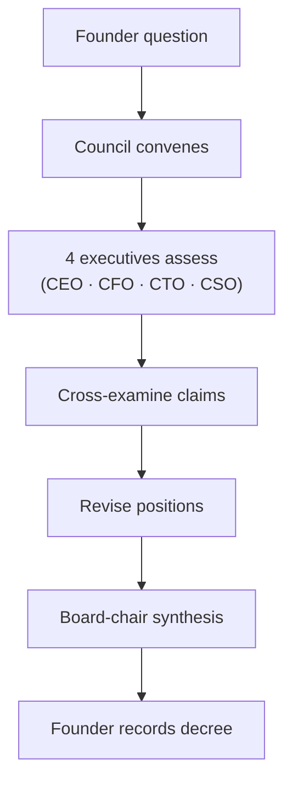
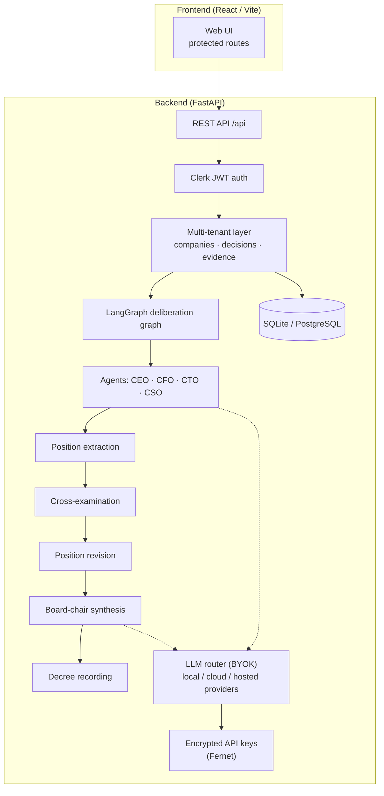

# Pantheon

[](LICENSE)
[](backend/README.md)
[](frontend/package.json)

**Pantheon** is an open-source AI council platform. It runs four independent
executive assessments (CEO, CFO, CTO, CSO), extracts positions, cross-examines
claims, revises positions, and synthesizes a board-chair recommendation — with
Founder-controlled decree recording.

Live demo: <https://pantheon.kunnankada.in>

## What Pantheon does

Pantheon turns a Founder's strategic question into a deliberated board
recommendation:



Each executive brings a distinct lens; positions are extracted, challenged,
and revised before a single consolidated recommendation is produced.

## Architecture



The agentic AI backend is the core of Pantheon: a deterministic LangGraph
workflow orchestrates four executive agents, cross-examination, revisions, and a
final board-chair synthesis, with a BYOK LLM router that never bakes in keys.

## Features

- FastAPI backend with SQLAlchemy models and startup seeding (SQLite default, PostgreSQL optional)
- LangGraph deliberation workflow: assess → extract → cross-examine → revise → synthesize
- BYOK (Bring Your Own Keys): API keys are entered by you, stored encrypted, never baked in
- React (Vite) frontend with protected routes and modern UI
- Multi-tenant companies, decisions, evidence register, operations, and performance scorecards

## Tech stack

- Backend: Python 3.11+, FastAPI, SQLAlchemy, LangGraph, Uvicorn
- Frontend: React 18, Vite, Tailwind CSS
- Auth: Clerk

## Quick start

### Backend

```bash
cd backend
python -m venv .venv
source .venv/bin/activate
pip install -r requirements.txt
cp .env.example .env   # fill in your values
.venv/bin/python -m uvicorn app.main:app --reload --host 127.0.0.1 --port 8000
```

API docs: <http://127.0.0.1:8000/docs>

### Frontend

```bash
cd frontend
npm install
cp .env.example .env   # fill in your values
npm run dev
```

## Configuration

All settings are read from `.env` (see `.env.example`). No API keys are
hardcoded. Generate `LLM_CONFIG_ENCRYPTION_KEY` with:

```bash
python -c "from cryptography.fernet import Fernet; print(Fernet.generate_key().decode())"
```

## Contributing

Contributions are welcome! Please:

1. Fork the repository
2. Create a feature branch (`git checkout -b feature/my-change`)
3. Commit your changes
4. Open a pull request

Please keep changes focused and add tests where applicable.

## License

MIT — see [LICENSE](LICENSE).
